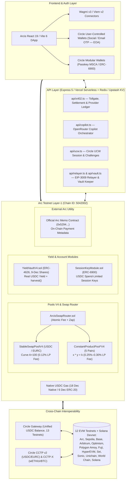
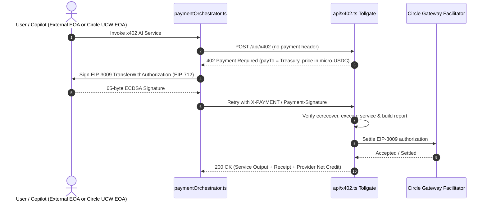

<div align="center">

# 🌊 Arcis Protocol
### Stablecoin Liquidity, Real-Yield Vaults & x402 AI Services on Arc L1

[-0052FF?style=for-the-badge&logo=ethereum&logoColor=white)](https://testnet.arcscan.app)
[](https://docs.arc.io)
[](https://eips.ethereum.org)
[](https://soliditylang.org)
[](https://book.getfoundry.sh)
[](#license)

<p align="center">
  <strong>Arcis</strong> (<code>arc-mini-app</code>) is a decentralized finance (DeFi) protocol, cross-chain liquidity hub, and x402 AI services marketplace purpose-built for <strong>Arc</strong> — Circle's Layer-1 blockchain where <strong>USDC is the native gas token</strong> with sub-second deterministic finality.
</p>

<p align="center">
  <a href="#executive-summary">Executive Summary</a> •
  <a href="#core-architecture--mechanisms">Architecture</a> •
  <a href="#smart-contracts--verified-deployments">Smart Contracts</a> •
  <a href="#liquidity-pools--vault-catalog">Pools & Vaults</a> •
  <a href="#x402-ai-services-marketplace--copilot">x402 AI Services</a> •
  <a href="#cross-chain-gateway--multi-network-engine">Circle Gateway & CCTP</a> •
  <a href="#getting-started--local-development">Local Setup</a>
</p>

---

</div>

## Executive Summary

**Arcis** combines Arc's native USDC gas architecture with Circle's cross-chain liquidity and programmable wallet stack (`App Kit`, `Unified Balance Kit`, `Gateway`, `CCTP v2` / `CCTP-X`, `User-Controlled Wallets`, `Modular Wallets`, and `x402` batching) into a single dark-mode institutional DeFi workspace.

```
                                  ╔═════════════════════════════════════════╗
                                  ║          Arcis Unified Interface        ║
                                  ╚═════════════════════════════════════════╝
                                                       │
         ┌─────────────────────┬───────────────────────┼───────────────────────┬─────────────────────┐
         ▼                     ▼                       ▼                       ▼                     ▼
 ┌───────────────┐     ┌───────────────┐       ┌───────────────┐       ┌───────────────┐     ┌───────────────┐
 │ 🌐 Unified    │     │ 💱 Pools V4   │       │ 🏦 Real-Yield │       │ 🤖 x402 AI    │     │ ⚡ Cross-Chain │
 │    Balance    │     │    AMM Suite  │       │    Vault V4   │       │  Marketplace  │     │    Routing    │
 │ (13 Networks) │     │ (Curve / CP)  │       │  (ERC-4626)   │       │  & Copilot    │     │(Gateway/CCTP) │
 └───────────────┘     └───────────────┘       └───────────────┘       └───────────────┘     └───────────────┘
         │                     │                       │                       │                     │
         └─────────────────────┴───────────────────────┴───────────────────────┴─────────────────────┘
                                                       │
                                  ╔═════════════════════════════════════════╗
                                  ║       Arc L1 Native USDC Engine         ║
                                  ║   (Sub-Second Finality • Zero ETH Gas)  ║
                                  ╚═════════════════════════════════════════╝
```

### Key Capabilities
1. **Native USDC Gas & Sponsored Mode**: All on-chain gas on Arc is paid natively in USDC (`0x3600...0000`) — no ETH required. In addition, an EIP-3009 Gasless Relayer sponsors daily free USDC transfers via off-chain EIP-712 authorizations.
2. **Pools V4 & Real-Yield ERC-4626 Vault**: Six V4 AMM pools (Curve-style `A=100` StableSwap for `USDC/EURC` plus five Constant-Product pools across `USDC`, `EURC`, `cirBTC`, and `WETH`) with on-chain per-LP fee harvesting (`LpFeeAccounting.sol`), alongside `YieldVaultV4` (ERC-4626 with virtual decimal offset and real USDC yield distribution).
3. **x402 AI Services Marketplace & Arc Copilot**: Nine official pay-per-call AI & on-chain analytics services priced in micro-USDC (`0.002`–`0.012` USDC) and settled via Circle Gateway EIP-3009 batching, plus a floating AI Copilot drawer (`ArcCopilotDrawer`) powered by OpenRouter with local intent fallback.
4. **Sub-Second Multi-Chain Gateway & CCTP Bridge**: Unified USDC balance across 13 testnet networks (12 EVM + Solana Devnet) via Circle Gateway, and direct EVM cross-chain bridging across 12 networks via CCTP v2 (USDC/EURC) and CCTP-X (wETH/cirBTC).
5. **Multi-Auth Wallet Architecture**: Supports external EVM wallets (Wagmi / Viem), Circle User-Controlled Wallets (Social Login & Email OTP created as EOAs), and Circle Modular Smart Contract Accounts (WebAuthn Passkey MSCA + ERC-6900 `SessionKeyModule.sol`).
6. **On-Chain Memos & Privacy Masking**: Attaches structured on-chain payment memos via Arc's official Memo router (`0x5294...e505`) and supports client-side Arc Privacy Sector (APS) balance masking.

> **For AI Agents & Contributors:** See [AGENTS.md](./AGENTS.md) for verified repo invariants (CCTP route matrix, x402 payer/treasury rules, `.env` quirks) and [DESIGN.md](./DESIGN.md) for the Arcis UI design system and token rules.

---

## Core Architecture & Mechanisms



---

## Smart Contracts & Verified Deployments

All protocol contracts are compiled with Solidity `0.8.24` (Cancun EVM) via Foundry and deployed to **Arc Testnet (Chain ID: `5042002`)**. Active V4 pool, vault, and router addresses default to the values in `src/config/poolsConfig.ts` and can be overridden via `VITE_POOL_V4_*` in `.env`.

| Contract | Type / Standard | Arc Testnet Address | Explorer |
|---|---|---|---|
| **Native USDC** | Gas Token (18 dec) & ERC-20 (6 dec) | `0x3600000000000000000000000000000000000000` | [ArcScan](https://testnet.arcscan.app/address/0x3600000000000000000000000000000000000000) |
| **EURC** | Circle Euro Coin (ERC-20, 6 dec) | `0x89B50855Aa3bE2F677cD6303Cec089B5F319D72a` | [ArcScan](https://testnet.arcscan.app/address/0x89B50855Aa3bE2F677cD6303Cec089B5F319D72a) |
| **cirBTC** | Circle Wrapped Bitcoin (8 dec) | `0xf0C4a4CE82A5746AbAAd9425360Ab04fbBA432BF` | [ArcScan](https://testnet.arcscan.app/address/0xf0C4a4CE82A5746AbAAd9425360Ab04fbBA432BF) |
| **WETH** | Bridged Wrapped Ether (18 dec) | `0x2c4047028a72803939b6fb674D01bC059B5C4961` | [ArcScan](https://testnet.arcscan.app/address/0x2c4047028a72803939b6fb674D01bC059B5C4961) |
| **StableSwapPoolV4** | Curve StableSwap AMM (`A=100`, USDC/EURC) | `0xC3EdDA15AdfaC31ADfC23aC86dC96d791f72bE8a` | [ArcScan](https://testnet.arcscan.app/address/0xC3EdDA15AdfaC31ADfC23aC86dC96d791f72bE8a) |
| **ConstantProductPoolV4** | Constant-Product AMM (USDC/cirBTC) | `0xf0e5f1d5C36a8362D96A8a43a441c6bb29416349` | [ArcScan](https://testnet.arcscan.app/address/0xf0e5f1d5C36a8362D96A8a43a441c6bb29416349) |
| **ConstantProductPoolWethV4** | Constant-Product AMM (USDC/WETH) | `0x4fB42dBbA5AD26723106bd56cA647dEb4a75Cd90` | [ArcScan](https://testnet.arcscan.app/address/0x4fB42dBbA5AD26723106bd56cA647dEb4a75Cd90) |
| **ConstantProductPoolEurcWethV4** | Constant-Product AMM (EURC/WETH) | `0x94f1fB8ab07146BB2C1f2A9AF155d51413a45809` | [ArcScan](https://testnet.arcscan.app/address/0x94f1fB8ab07146BB2C1f2A9AF155d51413a45809) |
| **ConstantProductPoolEurcCirBtcV4** | Constant-Product AMM (EURC/cirBTC) | `0x4e46D1D72897Ed90a18E94e974491EEfacFf8f6d` | [ArcScan](https://testnet.arcscan.app/address/0x4e46D1D72897Ed90a18E94e974491EEfacFf8f6d) |
| **ConstantProductPoolCirBtcWethV4** | Constant-Product AMM (cirBTC/WETH) | `0xBb8e2abA93D55f28C252F211DD7fd04A649ee7F3` | [ArcScan](https://testnet.arcscan.app/address/0xBb8e2abA93D55f28C252F211DD7fd04A649ee7F3) |
| **YieldVaultV4** | ERC-4626 Real-Yield Vault (USDC) | `0xb2a6D2BF896b431a77FB9198519fE334Caf39e9A` | [ArcScan](https://testnet.arcscan.app/address/0xb2a6D2BF896b431a77FB9198519fE334Caf39e9A) |
| **ArcisSwapRouter** | Atomic Fee & Zap Swap Router | `0x22733d5C4C91C7BEF2BED43e3f3F42B2d91DfcD4` | [ArcScan](https://testnet.arcscan.app/address/0x22733d5C4C91C7BEF2BED43e3f3F42B2d91DfcD4) |
| **Arc Memo Contract** | External Official Arc Metadata Router | `0x5294E9927c3306DcBaDb03fe70b92e01cCede505` | [ArcScan](https://testnet.arcscan.app/address/0x5294E9927c3306DcBaDb03fe70b92e01cCede505) |

*Protocol treasury addresses (`VITE_EVM_TREASURY_ADDRESS`, `X402_TREASURY_ADDRESS`) are configured per deployment via `.env`.*

---

## Mathematical & Economic Models

### 1. Curve Amplified StableSwap Invariant (`StableSwapPoolV4`)
For pegged stablecoin FX (`USDC/EURC`), `StableSwapPoolV4` implements the 2-token Curve StableSwap invariant with amplification coefficient $A = 100$ ($A n^n = 400$ for $n = 2$):

$$A n^n (x + y) + D = A D n^n + \frac{D^{n+1}}{n^n x y}$$

* **Swap Fee**: `12 bps` (`0.12%`) streamed directly into on-chain per-LP fee reserves (`LpFeeAccounting.sol`) so LPs can call `harvest()` without burning LP shares.
* **Slippage Guarded**: Only explicit `minLpShares` / `minOut` entrypoints are exposed.

### 2. Constant-Product AMM ($x \cdot y = k$)
For volatile pairs (`USDC/cirBTC`, `USDC/WETH`, `EURC/WETH`, `EURC/cirBTC`, `cirBTC/WETH`), Arcis V4 pools maintain the constant-product curve:

$$\Delta y = \frac{y \cdot \Delta x \cdot (1 - \phi)}{x + \Delta x \cdot (1 - \phi)}$$

where $\phi = 0.0025$ (`25 bps`) for `cirBTC` stable pairs and $\phi = 0.0030$ (`30 bps`) for `WETH` pairs. All V4 pools inherit `LpFeeAccounting` for pro-rata on-chain fee harvesting in both underlying tokens.

### 3. ERC-4626 Real Yield Vault (`YieldVaultV4`)
`YieldVaultV4.sol` distributes real USDC cash without inflationary reward tokens:

$$\text{Share Price} = \frac{\text{Total Assets (USDC)}}{\text{Total Supply Shares}}$$

* **Inflation Attack Defense**: Uses `_decimalsOffset() = 3` (9 share decimals for 6-decimal USDC).
* **Cost-Basis & Harvest**: Tracks `principalAssets[user]` on-chain and lets depositors call `harvest()` to claim accrued USDC yield (`convertToAssets(balanceOf(user)) - principalAssets[user]`) without exiting principal, protected by a same-block JIT deposit guard (`lastDepositBlock`).
* **Slippage Guards**: Exposes `depositWithMinShares` and `redeemWithMinAssets`.

---

## Liquidity Pools & Vault Catalog

Configured in `src/config/poolsConfig.ts` across two categories (`liquidity` and `vault`); TVL, reserves, and 24h volume are read live on-chain.

| Pool / Vault Name | Category | Risk Profile | Fee / Yield Source | Key Features |
|---|---|---|---|---|
| **USDC / EURC** | Liquidity AMM | 🟢 Safe | `0.12%` Swap Fee to LPs | Curve StableSwap (`A=100`), 1-Click Zap, `harvest()` |
| **USDC / cirBTC** | Liquidity AMM | 🟡 Medium | `0.25%` Swap Fee to LPs | Constant-Product, 1-Click Zap, `harvest()` |
| **USDC / WETH** | Liquidity AMM | 🟡 Medium | `0.30%` Swap Fee to LPs | Constant-Product, 1-Click Zap, `harvest()` |
| **EURC / WETH** | Liquidity AMM | 🟡 Medium | `0.30%` Swap Fee to LPs | Cross-Pair Constant-Product, Dual Deposit, `harvest()` |
| **EURC / cirBTC** | Liquidity AMM | 🟡 Medium | `0.25%` Swap Fee to LPs | Cross-Pair Constant-Product, Deadline Guard, `harvest()` |
| **cirBTC / WETH** | Liquidity AMM | 🟡 Medium | `0.30%` Swap Fee to LPs | Bluechip Cross-Pair Constant-Product, `harvest()` |
| **USDC Yield Vault** | ERC-4626 Vault | 🔵 Low | Protocol Revenue Share | Single-Asset USDC, 9-Dec Shares, `harvest()` |

---

## x402 AI Services Marketplace & Copilot

Arcis implements an HTTP `402 Payment Required` (**x402**) tollgate (`api/x402.ts`) settled in USDC through Circle Gateway's EIP-3009 batching facilitator, alongside an interactive **Arc AI Copilot** drawer (`src/components/copilot/ArcCopilotDrawer.tsx`).



### Official x402 Services (`src/config/x402/manifests/`)
All 9 official manifests charge a `50 bps` (`0.5%`) protocol fee routed through `X402_TREASURY_ADDRESS`, with providers withdrawing net earnings via signed `ProviderLedgerAuthorization` requests. The four reporting & risk agents share the `arcis.institutional-report/v1` envelope (`src/services/x402/institutionalReport.ts`).

| Service ID | Name | Category | Price (USDC) |
|---|---|---|---|
| `arc-cross-dex-arbitrage-sentinel` | Cross-DEX Arbitrage Sentinel | Arbitrage | `0.005` |
| `arc-deep-liquidity-slippage-optimizer` | Liquidity Depth & Slippage Scout | Liquidity & Routing | `0.002` |
| `arc-flash-loan-yield-radar` | Flash-Loan & Liquidation Radar | Yield & Flash-Loan | `0.008` |
| `arc-mempool-mev-shield` | Mempool MEV Shield Simulator | MEV & Security | `0.004` |
| `arc-cross-chain-gateway-flow-indexer` | Cross-Chain Gateway Flow Indexer | Cross-Chain Gateway | `0.003` |
| `arc-gateway-fee-route-scout` | Gateway vs CCTP Route Scout | Cross-Chain Gateway | `0.003` |
| `arc-yield-vault-analytics` | USDC Yield Vault Analytics | Yield & Flash-Loan | `0.002` |
| `arc-portfolio-risk-exposure` | Portfolio Risk & Exposure Engine | Risk & Compliance | `0.004` |
| `arc-vault-yield-tax-report` | Vault Yield & Tax Reporter | Reporting & Tax | `0.012` |

---

## Cross-Chain Gateway & Multi-Network Engine

Arcis aggregates a unified USDC balance across **13 testnet networks** (12 EVM chains + Solana Devnet) using **Circle Gateway** (`src/config/gatewayConfig.ts`), and offers EVM cross-chain bridging across **12 selectable chains** (`src/config/bridgeConfig.ts`, `src/config/bridgeRouteMatrix.ts`):

- **Gateway Instant (Unified Balance)**: USDC-only burn-and-mint across all 13 Gateway testnets.
- **Direct Bridge — CCTP v2**: USDC across all 12 selectable EVM chains; EURC between Arc Testnet and Ethereum Sepolia, Base Sepolia, and Avalanche Fuji.
- **Direct Bridge — CCTP-X**: `wETH` and `cirBTC` between Arc Testnet and Ethereum Sepolia (with mandatory forwarding enabled).

### Supported Gateway Testnet Networks & Domain IDs
Configured in `src/config/networks/networkRegistry.ts`:

| Network | Domain ID | Bridge Tab | USDC Contract Address |
|---|---|---|---|
| **Arc Testnet** | `26` | EVM (CCTP v2 / X) | `0x3600000000000000000000000000000000000000` |
| **Ethereum Sepolia** | `0` | EVM (CCTP v2 / X) | `0x1c7D4B196Cb0C7B01d743Fbc6116a902379C7238` |
| **Avalanche Fuji** | `1` | EVM (CCTP v2) | `0x5425890298aed601595a70ab815c96711a31bc65` |
| **Optimism Sepolia** | `2` | EVM (CCTP v2) | `0x5fd84259d66Cd46123540766Be93DFE6D43130D7` |
| **Arbitrum Sepolia** | `3` | EVM (CCTP v2) | `0x75faf114eafb1BDbe2F0316DF893fd58CE46AA4d` |
| **Solana Devnet** | `5` | Gateway Only | `4zMMC9srt5Ri5X14GAgXhaHii3GnPAEERYPJgZJDncDU` |
| **Base Sepolia** | `6` | EVM (CCTP v2) | `0x036CbD53842c5426634e7929541eC2318f3dCF7e` |
| **Polygon PoS Amoy** | `7` | EVM (CCTP v2) | `0x41e94eb019c0762f9bfcf9fb1e58725bfb0e7582` |
| **Unichain Sepolia** | `10` | EVM (CCTP v2) | `0x31d0220469e10c4E71834a79b1f276d740d3768F` |
| **Sonic Testnet** | `13` | EVM (CCTP v2) | `0x0BA304580ee7c9a980CF72e55f5Ed2E9fd30Bc51` |
| **World Chain Sepolia** | `14` | EVM (CCTP v2) | `0x66145f38cBAC35Ca6F1Dfb4914dF98F1614aeA88` |
| **Sei Testnet** | `16` | EVM (CCTP v2) | `0x4fCF1784B31630811181f670Aea7A7bEF803eaED` |
| **HyperEVM Testnet** | `19` | EVM (CCTP v2) | `0x2B3370eE501B4a559b57D449569354196457D8Ab` |

---

## Tech Stack

| Category | Technology |
|---|---|
| **Smart Contracts** | Solidity `0.8.24`, OpenZeppelin Contracts v5, Foundry (`forge`, `cast`) |
| **Blockchain Target** | Arc Testnet (Chain ID: `5042002`, Native Gas: USDC) |
| **Frontend Framework** | React 19, Vite 6, TypeScript 5.6 |
| **Web3 Libraries** | Viem v2, Wagmi v3, TanStack React Query v5, `@solana/web3.js` |
| **Circle & x402 SDKs** | `@circle-fin/app-kit`, `@circle-fin/unified-balance-kit`, `@circle-fin/user-controlled-wallets`, `@circle-fin/w3s-pw-web-sdk`, `@circle-fin/modular-wallets-core`, `@circle-fin/x402-batching`, `@x402/core`, `@x402/evm` |
| **Styling & UI** | Tailwind CSS v4, Lucide React, `@web3icons/react` |
| **Backend & Storage** | Express 5 (`server.ts`) + Vercel Serverless (`api/*.ts`), Redis / Upstash KV (`ioredis`) |
| **Testing** | Vitest 5 (`npm test`), Foundry (`forge test`) |

---

## Getting Started & Local Development

### 1. Prerequisites
- [Node.js](https://nodejs.org/) **22.x** (specified in `package.json` `engines`)
- [Foundry](https://book.getfoundry.sh/) (`curl -L https://foundry.paradigm.xyz | bash`) — required only for contract compilation/deployment
- Arc Testnet USDC ([Circle Faucet](https://faucet.circle.com))

### 2. Clone & Install Dependencies
```bash
# Clone the repository
git clone <repository-url>
cd arc-mini-app

# Install app & API dependencies
npm install

# (Optional) Install Foundry contract dependencies
cd contracts
forge install
cd ..
```

### 3. Environment Setup
Copy the canonical template and fill in the credentials you need:
```bash
cp .env.example .env
```

Key environment variables (see [`.env.example`](./.env.example) for the complete list):
- **Core Network**: `VITE_APP_ENV=testnet`, `VITE_ARC_RPC_URL=https://rpc.testnet.arc.io`, `PORT=3000`
- **Circle Server & SDK Credentials**: `CIRCLE_API_KEY` *(server-only — never prefix with `VITE_`)*, `VITE_CIRCLE_APP_ID`, `VITE_CLIENT_KEY`, `VITE_CLIENT_URL`, `KIT_KEY`
- **AI Copilot & x402 LLM Engine (server-only)**: `OPENROUTER_API_KEY`, `OPENROUTER_MODEL`, `X402_LLM_MAX_OUTPUT_TOKENS=1600`
- **x402 Settlement & Treasury**: `ENABLE_GATEWAY_SETTLE=false`, `X402_TREASURY_ADDRESS`, `X402_TREASURY_PRIVATE_KEY`, `X402_RECONCILIATION_SECRET`
- **Relayer & Storage**: `RELAYER_PRIVATE_KEY`, `REDIS_URL` / `KV_REST_API_*`
- **Foundry Deployer Key**: Keep `PRIVATE_KEY` in `contracts/.env` (or pass via Foundry CLI) — the Node server never reads it.

### 4. Run & Verify Locally
```bash
# Start Vite dev server (with built-in /api/* middleware on port 3000)
npm run dev
# Open http://localhost:3000

# Run full typecheck (app + api) and Vitest test suite
npm run ci

# Verified production build (typecheck + Vite build + gzip bundle budget check)
npm run build:verified

# Run standalone Express production server (serves dist/ + all /api/* including /api/vault)
npm run start

# Verify live CCTP/CCTP-X route matrix against Circle's sandbox registry
npm run verify:cctp-routes
```

---

## Smart Contract Testing & Deployment

### Run Foundry Test Suite
```bash
cd contracts
forge test -vvv
```

### Deploy V4 Contracts to Arc Testnet
Foundry scripts live in `contracts/script/` (`DeployV4.s.sol`, `DeployVaultV4.s.sol`, `DeployConstantProductV4.s.sol`, `DeployWethPool.s.sol`, `DeployEurcWethPool.s.sol`, `DeployEurcCirBtcPool.s.sol`, `DeployCirBtcWethPool.s.sol`, `DeployRouter.s.sol`, `DeploySessionKey.s.sol`). Example:
```bash
cd contracts
forge script script/DeployVaultV4.s.sol \
  --rpc-url arc_testnet \
  --broadcast \
  --slow
```

### Verify Contracts on ArcScan
```bash
forge verify-contract <CONTRACT_ADDRESS> src/v4/StableSwapPoolV4.sol:StableSwapPoolV4 \
  --chain-id 5042002 \
  --verifier blockscout \
  --verifier-url https://testnet.arcscan.app/api/
```

---

## Repository Structure

```
arc-mini-app/
├── AGENTS.md                         # Verified technical invariants for AI agents
├── DESIGN.md                         # Arcis UI design system & token specification
├── .env.example                      # Canonical environment variable template
├── server.ts                         # Standalone Express 5 server (SPA + /api/* + keepers)
├── vercel.json                       # Vercel serverless functions & SPA rewrite config
├── vite.config.ts                    # Vite 6 config, bundle splitting & dev API middleware
├── api/                              # Serverless / Express API handlers & utilities
│   ├── copilot.ts                    # AI Copilot orchestrator (OpenRouter + fallback)
│   ├── x402.ts                       # x402 tollgate, settlement & provider ledger
│   ├── ucw.ts                        # Circle User-Controlled Wallet auth & challenges
│   ├── relayer.ts                    # EIP-3009 gasless USDC transfer relayer
│   ├── vault.ts                      # YieldVaultV4 status & keeper endpoint
│   ├── swap.ts, faucet.ts, cache.ts, history.ts, health.ts
│   └── _utils/                       # Redis/KV storage, x402 payout/reconciler/latency, rate limiter
├── contracts/                        # Foundry Smart Contract Suite (Solidity 0.8.24)
│   ├── src/
│   │   ├── ArcisSwapRouter.sol       # Single-tx swap with fee forwarding & zapIn
│   │   ├── SessionKeyModule.sol      # ERC-6900 session key module for Circle MSCA
│   │   ├── v4/                       # Active V4 AMM pools, LpFeeAccounting & YieldVaultV4
│   │   ├── v2/, v3/                  # Previous contract generations
│   │   ├── interfaces/               # IERC20Like
│   │   └── mocks/                    # MockERC20
│   ├── script/                       # Foundry deployment & ownership scripts
│   └── test/                         # Unit, audit PoC & invariant test suites
├── scripts/                          # CI, bundle budget, CCTP route & x402 audit scripts
└── src/
    ├── App.tsx                       # Main shell, lazy-loaded tabs/modals & wallet resolution
    ├── index.css                     # Tailwind v4 theme, Arc/Aave tokens & animations
    ├── components/
    │   ├── home/                     # HomePage overview
    │   ├── unified/                  # Unified Balance (Circle Gateway) UI
    │   ├── pools/                    # PoolsTab, PoolCard, PoolsTable, YieldCalculator, actions
    │   ├── marketplace/              # x402 AI Services Marketplace & Provider Hub
    │   ├── copilot/                  # ArcCopilotDrawer, CopilotRuntime, SessionKeyModal
    │   ├── bridge/, swap/, fintech/, history/, portfolio/, privacy/, common/
    │   └── Header.tsx, Footer.tsx, SendModal.tsx, SwapModal.tsx, BridgeModal.tsx, CircleAuthModal.tsx
    ├── config/                       # Network registry, poolsConfig, bridgeRouteMatrix, x402 manifests
    ├── context/                      # Multi-chain wallet & app state providers
    ├── hooks/                        # Web3, UCW, Modular Wallet, Pools, Gateway & Copilot hooks
    ├── services/                     # Viem RPC, Gateway, CCTP/CCTP-X, Swap, Memo & x402 engines
    ├── types/                        # Bridge, swap, x402, marketplace & wallet TypeScript types
    └── utils/                        # Math, formatting, error normalization, x402 readiness & tests
```

---

## Security & Best Practices

1. **Native USDC Decimal Alignment**: Arc uses 18 decimals for native gas balances (`msg.value`) and 6 decimals for the ERC-20 USDC interface (`0x3600...0000`). V4 pools and vault contracts strictly operate on the 6-decimal ERC-20 interface, while CCTP-X `msg.value` relayer fees use `CHAIN_NATIVE_MAP` decimals.
2. **Reentrancy & Slippage Protection**: State-mutating pool, router, and vault functions use OpenZeppelin `ReentrancyGuard`, explicit slippage minimums (`minOut`, `minLpShares`, `depositWithMinShares`, `redeemWithMinAssets`), and same-block JIT harvest guards.
3. **No Native `receive()` / `fallback()`**: V4 pools and `YieldVaultV4` intentionally omit `receive()` and `fallback()`, causing accidental native-value sends to revert cleanly at the EVM level.
4. **SafeERC20 & Server-Side Secret Isolation**: Vault token movements use OpenZeppelin `SafeERC20`, and all private keys and API credentials (`CIRCLE_API_KEY`, `OPENROUTER_API_KEY`, `RELAYER_PRIVATE_KEY`, `X402_TREASURY_PRIVATE_KEY`) remain strictly server-side.

---

## Useful Links & Resources

- **Arc Official Documentation**: [docs.arc.io](https://docs.arc.io)
- **ArcScan Testnet Explorer**: [testnet.arcscan.app](https://testnet.arcscan.app)
- **Circle Faucet**: [faucet.circle.com](https://faucet.circle.com)
- **Circle Developer Docs**: [developers.circle.com](https://developers.circle.com)
- **Foundry Book**: [book.getfoundry.sh](https://book.getfoundry.sh)

---

## License

This project is licensed under the **MIT License**.

<div align="center">
  <sub>Built for the Circle & Arc Blockchain Ecosystem.</sub>
</div>
