# Arcis: Vercel Build Log Analizi ve Düzeltme Raporu

**Deploy:** `main @ 1f3b175` · Vercel CLI 66.2.0 · iad1 · Süre ≈ 4 dk (install 1 dk 44 sn)
**Yöntem:** Log satır satır sınıflandırıldı ve her bulgu repo üzerinde doğrulandı (yerel tekrar üretim, `npm audit`, import grafiği taraması).

---

## 0. Özet

| # | Bulgu | Log'daki yeri | Önem | Deploy'u durdurdu mu? | Durum |
|---|---|---|---|---|---|
| 1 | Serverless fonksiyonlarda uzantısız göreli import'lar (TS2835/TS2834, yaklaşık 290 satır) | 14:41:59 → 14:42:21 | 🔴 **P0: çalışma anında `/api/*` çökme riski** | Hayır (Vercel tip hatalarını sadece raporluyor) | ✅ Tamamlandı (`tsconfig.api.json` + codemod + `typecheck` zincirlendi) |
| 2 | `ioredis` "not constructable" (TS2351) | redisStorage.ts:109, rateLimiter.ts:32 | 🟠 P1 | Hayır | ✅ Tamamlandı (`{ Redis }` isimli export + `typecheck` exit 0) |
| 3 | viem / `unknown` tipli zincirleme hatalar (TS2339, TS2345, TS2322) | gatewayService, vault, vaultKeeper, resilientRpcService… | 🟠 P1 (büyük kısmı #1 + `strictNullChecks: false` yan etkisi) | Hayır | ✅ Tamamlandı (`api/tsconfig.json` bağımsız `strict` + `NodeNext`, TS 5.9.3 ile 0 hata) |
| 4 | 82 güvenlik açığı (79'u production bağımlılıklarında) | 14:40:17 | 🟠 P1 | Hayır | ✅ Uygulandı (82 → 60; 9 kök paketten 6'sı kapatıldı, kalan 3 upstream/breaking belgelendi) |
| 5 | 3,6 MB'lık JS chunk ve 2,4 MB'lık hero görseli | 14:41:47 | 🟡 P2 (performans) | Hayır | ✅ Tamamlandı (en büyük chunk 3,67 MB → 2,13 MB; görseller 5,51 MB → 173 KB WebP) |
| 6 | Konfigürasyon uyarıları (`engines`, `.npmrc`, `memory`, install-scripts) | birçok satır | 🟡 P2 | Hayır | ✅ Uygulandı (`engines: "22.x"`, `.npmrc` temizlendi, `vercel.json` `memory` silindi & `installCommand` sadeleştirildi) |
| 7 | Rollup `/*#__PURE__*/` ve `vm` externalize uyarıları | 14:41:18 → 14:41:29 | ⚪ P3 (gürültü, üçüncü taraf kodu) | Hayır | ✅ Tamamlandı (`onwarn` ile 6 `ox` + `asn1.js → vm` temizlendi; beklenmeyen externalize fail-fast) |

> [!IMPORTANT]
> Logun "temiz" görünen kısmında (`build:verified` → typecheck ✓, vite build ✓, budget ✓) bir sorun yok. Hataların **tamamı** frontend build bittikten sonra, Vercel'in `api/*.ts` dosyalarını serverless fonksiyon olarak derlediği ikinci aşamada çıkıyor (`Installing dependencies...` → `Using TypeScript 5.9.3`). Yerel `npm run typecheck` bu hataları görmüyor, çünkü yerelde `moduleResolution: "bundler"` kullanılıyor, Vercel ise Node ESM kurallarıyla kontrol ediyor.

---

## 1. 🔴 P0: Serverless fonksiyonlarda uzantısız import'lar

### Belirti
```
api/cache.ts(6,38): error TS2835: Relative import paths need explicit file extensions in ECMAScript
imports when '--moduleResolution' is 'node16' or 'nodenext'. Did you mean './_utils/apiResponse.js'?
src/services/arcGasService.ts(14,65): error TS2834: ... Consider adding an extension to the import path.
```

### Kök neden
1. [package.json](file:///c:/arc-mini-app/package.json) içinde `"type": "module"` var. Bu yüzden `@vercel/node` her `api/*.ts` dosyasını **saf Node ESM** olarak ele alıyor ve tip kontrolünü `node16/nodenext` çözümlemesiyle yapıyor. [tsconfig.json](file:///c:/arc-mini-app/tsconfig.json) içindeki `"moduleResolution": "bundler"` bu aşamada geçerli olmuyor.
2. Node ESM'de göreli import'un **tam dosya yolu** olması gerekir: `./_utils/apiResponse` yazılırsa çözümlenmez, `./_utils/apiResponse.js` yazılması gerekir. Klasör import'u (`./rpc`) da çözümlenmez, `./rpc/index.js` gerekir.
3. Vercel tip hatalarını **uyarı olarak basıp deploy'a devam ediyor**. "Deployment completed" yazmasının sebebi bu.

### Neden P0?
`@vercel/node` her `.ts` dosyasını tek tek `.js`'e çevirir ve import yollarını **değiştirmez**. Çıktıdaki `import … from './_utils/apiResponse'` satırı Node 22'de `ERR_MODULE_NOT_FOUND` hatası verir ve fonksiyon `500 FUNCTION_INVOCATION_FAILED` döner. Bu, statik site çalışırken `/api/*` uç noktalarının (copilot, x402, ucw, faucet, health, history, cache, vault, swap, relayer) **ilk istekte çökmesi** demek. Frontend açılıyor diye "production'da çalışıyor" izlenimi oluşabilir.

> [!WARNING]
> Bunu üretimde **önce doğrulayın**: `curl -i https://<domain>/api/health` çalıştırın ve Vercel Dashboard → Deployment → **Runtime Logs** ekranında `ERR_MODULE_NOT_FOUND` / `Cannot find module '/var/task/api/_utils/...'` arayın. Bu ortamda web araması kullanılamadığı için Vercel'in güncel çalışma anı davranışı canlı olarak teyit edilemedi. Tespit, Node ESM kuralı ve log'daki derleyici ayarına dayanıyor.

### Kapsam (yerelde ölçüldü)
`api/*.ts` ve `api/_utils/*.ts` girişlerinden çıkan import grafiği:

| Ölçüm | Değer |
|---|---|
| Grafikteki dosya sayısı (node_modules hariç) | **113** (25 `api/` + 88 `src/`) |
| Uzantısız göreli import | **308** |
| Klasör import'u (TS2834) | **15**: `./rpc`, `../rpc`, `../src/services/rpc` (12 adet) → `…/rpc/index.js`; `config/x402/manifests` (2 adet, `api/x402.ts` ve `services/x402/nextActions.ts`) → `…/manifests/index.js` |

En yoğun klasörler: `src/services` (20), `src/utils` (15), `api/_utils` (15), `src/config` (12), `src/config/x402/manifests` (10), `src/services/x402` (9).

Hata, Vercel ayarıyla yerelde de üretilebiliyor (`module/moduleResolution: NodeNext`, sadece `api/**`): **88 hata, 20 dosya**. Bu sayı Vercel'dekinden düşük, çünkü `tsc` çözümleyemediği import'ların içine inmiyor. Vercel ise her girişi ayrı ayrı denetliyor.

### Düzeltme (önerilen: A)

**A. Server grafiğindeki göreli import'lara `.js` uzantısı ekleyin.**
- `moduleResolution: "bundler"` `.js` uzantısını `.ts` dosyasına eşler. Bu yüzden **Vite, Vitest ve yerel `tsc` aynen çalışmaya devam eder**, sadece Vercel'in Node ESM çalışma ortamı da memnun olur.
- Klasör import'larını `…/index.js` olarak yazın.
- Sadece tipler için yapılan import'lar (`import type … from '../../hooks/useWalletTestnetBalances'`) da TS2835 veriyor. Onlara da uzantı ekleyin.
- Codemod ile yapılabilir: grafikteki 113 dosyada `from '…'` ve `import('…')` ifadelerini dolaşıp, hedef `X.ts` ise `X.js`, hedef klasörse `X/index.js` yazan küçük bir script yeterli. Tutarlılık için tüm `src/`'ye uygulamak da güvenli.

**Regresyon koruması (bu adım şart):** Kökte, Vercel'in kontrolünü taklit eden bir `tsconfig.api.json` oluşturun ve `typecheck` script'ine ekleyin:
```jsonc
// tsconfig.api.json
{
  "extends": "./tsconfig.json",
  "compilerOptions": { "module": "NodeNext", "moduleResolution": "NodeNext",
                       "allowImportingTsExtensions": false, "noEmit": true },
  "include": ["api/**/*.ts"],
  "exclude": ["**/__tests__/**", "**/*.test.ts"]
}
```
```json
"typecheck": "tsc -b --pretty false && tsc -p tsconfig.api.json --pretty false"
```
Böylece uzantısız bir import `build:verified` aşamasında **Vercel'e gitmeden** yakalanır.

**B. (Alternatif) API'yi esbuild ile tek dosyaya bundle'layın.** Repoda zaten `build:server` adında esbuild script'i var. Ama Vercel'de bunu yapmak Build Output API'ye ya da `api/` girişlerinin üretilmiş dosyaya yönlendirilmesine geçmeyi gerektirir. Daha invaziv olduğu için ikinci tercih.

> [!NOTE]
> Son commit (`1f3b175`) kök `tsconfig.json`'u `references` yapısından tek düz yapılandırmaya çevirdi ve `api/tsconfig.json`'u ekledi. Bu dosyalar `bundler` çözümlemesini korusa da Vercel'in ESM kontrolünü değiştirmiyor. Sorunu tsconfig ayarıyla çözmeye çalışmayın. Çözüm kaynak koddaki import yolları.

### ✅ Uygulama Sonucu (Madde 1)
- **AST tabanlı `.js` uzantı codemod'u uygulandı:** `api/**/*.ts` (testler hariç 25 giriş) üzerinden tam import grafiği tarandı; **113 dosya** ziyaret edildi, **84 dosya** güncellendi, toplam **308 göreli import/export** (`302 import` + `6 export`) explicit `.js` uzantısına çevrildi.
  - **15 klasör import'u** `…/index.js` biçimine dönüştürüldü (**13** adet `rpc/index.js`, **2** adet `manifests/index.js`).
  - Grafikte `@/` alias kullanan, `.tsx` hedefleyen veya çözülemeyen göreli import bulunmadı (0 adet).
- **Regresyon koruması eklendi:** Kökte [tsconfig.api.json](file:///c:/arc-mini-app/tsconfig.api.json) oluşturuldu (`module`/`moduleResolution`: `"NodeNext"`, `allowImportingTsExtensions: false`, `noEmit: true`, `include: ["api/**/*.ts", "src/vite-env.d.ts"]`). Not: `src/vite-env.d.ts` dahil edilmediğinde paylaşılan 4 `src/` dosyasında 31 adet `ImportMeta.env` TS2339 hatası çıkıyordu; eklenince tamamı temizlendi.
- [package.json](file:///c:/arc-mini-app/package.json) içine `"typecheck:api": "tsc -p tsconfig.api.json --pretty false"` eklendi ve Madde 2 ile birlikte ana `"typecheck"` script'ine zincirlendi.
- **Doğrulama sonuçları:**
  - `npm run typecheck:api` → **0× TS2835**, **0× TS2834**, **0× viem/`unknown`/TS7006 hatası**.
  - `npm run typecheck` → **PASS** (exit 0)
  - `npm run build:server` → **PASS** (`dist-server/server.js`, 609.1 kb)
  - `npm run build:verified` → **PASS** (`typecheck` ✓, `vite build` ✓, `budget` ✓: `react-vendor` 59.9 KB, en büyük chunk 962.6 KB, toplam JS 1884.8 KB)
  - `npm test` → **196/203 dosya, 1926/1933 test PASS** — `.js` uzantı değişikliğinden kaynaklanan **0 regresyon**. Kalan 7 test hatası (`copilotContract`, `copilotSlippageSafety`, `swapSlippageClamp`, `walletSettingsService`, `poolsPhase1Remaining`, `copilotActionWarnings`, `copilotSettingsModal`) `HEAD (1f3b175)` üzerinde önceden mevcut olan slippage üst sınırı (2% → 5%) ve uyarı metni beklentisi farklarıdır.

---

## 2. 🟠 P1: `ioredis` TS2351 "This expression is not constructable"

**Yer:** [redisStorage.ts:108-109](file:///c:/arc-mini-app/api/_utils/redisStorage.ts#L108-L109), [rateLimiter.ts:29-32](file:///c:/arc-mini-app/api/_utils/rateLimiter.ts#L29-L32)
```ts
const { default: Redis } = await import('ioredis')   // NodeNext: default = CJS module.exports namespace tipi
new Redis(redisUrl, …)                                // TS2351
```
**Neden:** ioredis 6.0.0 bir CJS paketi ve `.d.ts` dosyası `export { default }` kullanıyor. NodeNext altında ESM'den alınan `default`, TS'te modülün tamamı olarak tiplenir, sınıf olarak değil.

**Çalışma anı (Node 22'de test edildi):** `m.Redis`, `m.default` ve `m.default.Redis` üçü de `function` döndürüyor. Yani bugün çalışma anında kırık değil, ama tip güvenliği yok.

**Düzeltme:** İsimli export'u kullanın. Hem tiplerde hem çalışma anında mevcut:
```ts
const { Redis } = await import('ioredis')
```

### ✅ Uygulama Sonucu (Madde 2)
- [redisStorage.ts:108](file:///c:/arc-mini-app/api/_utils/redisStorage.ts#L108) ve [rateLimiter.ts:29](file:///c:/arc-mini-app/api/_utils/rateLimiter.ts#L29) içindeki `const { default: Redis } = await import('ioredis')` ifadeleri `const { Redis } = await import('ioredis')` olarak güncellendi (repoda başka `ioredis` import'u yok).
- [package.json:11](file:///c:/arc-mini-app/package.json#L11) içinde `"typecheck"` script'i `"tsc -b --pretty false && tsc -p tsconfig.api.json --pretty false"` biçiminde zincirlendi; artık `npm run typecheck` ve `npm run build:verified` Vercel'in NodeNext ESM denetimini de çalıştırıyor.
- **Doğrulama sonuçları:**
  - Node 22 çalışma anı kontrolü: `import('ioredis')` → `typeof m.Redis === 'function'` (`isClass = true`).
  - `npm run typecheck` (`tsc -b` + `tsc -p tsconfig.api.json`) → **PASS (exit 0, 0 hata)**.
  - İlgili API testleri (`redisStorageSettlement`, `x402Stats`, `healthDisclosure`, `x402HttpE2E`) → **4/4 dosya, 19/19 test PASS**.
  - `npm run build:server` → **PASS** (`dist-server/server.js`, 609.1 kb).
  - `npm run build:verified` → **PASS** (`typecheck` ✓, `vite build` ✓, `budget` ✓).

---

## 3. 🟠 P1: viem ve `unknown` zincirleme hataları

| Dosya | Hata |
|---|---|
| `api/vault.ts:58-71`, `api/_utils/vaultKeeper.ts:95-205` | `readContract` için `authorizationList` eksik; `writeContract` için `chain` eksik |
| `src/services/gatewayService.ts:155-930` | `args` / `unknown`, `account` eksik, `.write` yok |
| `src/config/gatewayConfig.ts:40-152` | `capabilities`, `tokens`, `cctpDomain` → `unknown` |
| `src/services/rpc/resilientRpcService.ts:204-292` | `rpcUrls`, `id`, `chainId`, `urls` → `unknown`; `account` uyumsuz |
| `src/services/sessionEnclaveService.ts:392` | `kzg` eksik |
| `src/services/modularWalletService.ts:182` | `Client` tipi `never`'a indirgenmiş (`cacheTime`) |
| `src/services/bridgeUcwService.ts`, `x402/reportDigest.ts`, `api/x402.ts:748-750` | `args`, `schema`, `callsServed` → `unknown` |

**Teşhis:** Yerel `tsc -b` (bundler çözümlemesi) bu dosyaların hiçbirinde hata vermiyor. viem'in tek kopyası kurulu (`viem@2.55.11 deduped`), yani "iki farklı viem sürümü" sorunu yok. Bu hatalar büyük olasılıkla **#1'in yan etkisi**: çözülemeyen import'lardan gelen değerler `any` oluyor, `Object.values(any)` ise `unknown[]` döndürüyor, viem'in koşullu tipleri de bu durumda `authorizationList: any` ya da `kzg` gibi alanları zorunlu hale getiriyor. Yerel NodeNext tekrarında da aynı tür zincirleme `TS7006 implicit any` hataları görüldü.

**Yapılacak:** #1 düzeltildikten sonra `tsc -p tsconfig.api.json` çalıştırın. Kalan hata varsa tek tek düzeltin. En olası gerçek aday: `vaultKeeper.ts`'deki `writeContract`, wallet client `chain` ile oluşturulmadıysa çağrıya `chain: arcTestnet` eklenmeli.

### ✅ Uygulama Sonucu (Madde 3)
- **Kök neden iki bileşenli olarak kesinleştirildi ve birebir tekrar üretildi (TypeScript 5.9.3):**
  1. `unknown` / `TS7006` / `args` / `callsServed` zincirleme hatalarının tamamı Madde 1 (`.js` uzantıları) sonrasında **tamamen kayboldu**. `api/vault.ts` ve `api/_utils/vaultKeeper.ts` kodlarında `chain`/`account` eksikliği bulunmadığı (`createWalletClient` zaten `account: relayer, chain: arcTestnet` ile kuruluyor) doğrulandı.
  2. Vercel log'undaki viem'e özgü `authorizationList` eksik (`vault.ts`, `vaultKeeper.ts`, `sessionEnclaveService.ts`), `kzg` eksik (`sessionEnclaveService.ts:392`) ve `Client` → `never` (`modularWalletService.ts:182`) hatalarının **`strictNullChecks: false`** altında birebir tetiklendiği doğrulandı (`tsc --noEmit --target ES2022 --module NodeNext --moduleResolution NodeNext --skipLibCheck`). `@vercel/node` derlemesinde [api/tsconfig.json](file:///c:/arc-mini-app/api/tsconfig.json) yalnızca `"extends": "../tsconfig.json"` ve `"noEmit": true` içerdiği için `strict` / `strictNullChecks` ayarı kalıtılmadığında viem'in koşullu tipleri opsiyonel alanları zorunlu hale getiriyordu.
- **Düzeltme:** [api/tsconfig.json](file:///c:/arc-mini-app/api/tsconfig.json) bağımsız (self-contained) hale getirildi; `"strict": true`, `"strictNullChecks": true`, `"module": "NodeNext"`, `"moduleResolution": "NodeNext"`, `"target": "ES2022"`, `"skipLibCheck": true` doğrudan tanımlandı ve `"include": ["**/*.ts", "../src/vite-env.d.ts"]` / `"exclude": ["**/__tests__/**", "**/*.test.ts"]` eklendi.
- **Doğrulama (yerel TypeScript 5.9.3 — Vercel ile birebir aynı sürüm):**
  - `npx tsc -p api/tsconfig.json --pretty false` → **PASS (exit 0, 0 hata)**
  - `npm run typecheck` (`tsc -b` + `tsc -p tsconfig.api.json`) → **PASS (exit 0, 0 hata)**
  - `npm run build:verified` → **PASS** (`typecheck` ✓, `vite build` ✓, `budget` ✓)

---

## 4. 🟠 P1: 82 güvenlik açığı (12 düşük, 12 orta, 58 yüksek, 0 kritik)

`--omit=dev` ile: **79** açık (12 düşük, 10 orta, 57 yüksek). Yani neredeyse tamamı runtime bağımlılıklarında.

| Paket (geçişli) | Kaynak (doğrudan bağımlılık) | Özet |
|---|---|---|
| `undici`, `@grpc/grpc-js` | `@circle-fin/w3s-pw-web-sdk@1.1.11` | TLS doğrulama atlatma, WebSocket DoS, CRLF/header injection |
| `toml` | `@circle-fin/app-kit@1.17.0` | Prototype pollution, DoS |
| `follow-redirects` | `@circle-fin/user-controlled-wallets@10.8.0` | Credential header sızıntısı |
| `zod` 3.25.x, `elliptic` | `@circle-fin/adapter-circle-wallets` (→ `@ethersproject/*`) | Bellek tüketimi, riskli kripto primitifi |
| `body-parser` | `express@5.2.1` (`server.ts`) | Sıkıştırılmış body DoS |
| `stream-json` | `@solana/web3.js@1.99.0` | DoS, prototype pollution |
| `uuid` 11.x | `@circle-fin/modular-wallets-core`, `@circle-fin/unified-balance-kit` | Buffer sınır kontrolü eksik |
| `vite`, `launch-editor` | `vite@6.4.3` | Sadece geliştirme sunucusu |
| `@vitest/mocker` | `vitest` | Sadece test ortamı |

> [!CAUTION]
> Log'daki `npm audit fix --force` önerisini **çalıştırmayın**. npm'in "fix" dediği şey birçok pakette büyük bir **sürüm düşürme**: `@circle-fin/app-kit@1.0.0`, `@walletconnect/ethereum-provider@2.19.4`, `@circle-fin/w3s-pw-web-sdk@1.0.13`, `vite-plugin-node-polyfills@0.2.0`. App Kit'in 1.15'ten eski sürümleri non-USDC köprülemeyi bozar (AGENTS.md: *Non-USDC bridging requires App Kit ≥1.15.0*).

**Önerilen sıra:**
1. `npm audit fix` (zorlamadan, semver uyumlu): `vite`, `vitest`, `@x402/core`, `@x402/evm`, `express`/`body-parser` için düzeltme mevcut. Sonra `npm test` ve `npm run build:verified` çalıştırın.
2. Circle SDK'larının getirdiği açıklar için `package.json` → `"overrides"` ile geçişli paketleri yamalı sürüme sabitleyin (`undici`, `follow-redirects`, `toml`, `@grpc/grpc-js`, `uuid`, `stream-json`). Her override'dan sonra ilgili akışı test edin (UCW girişi, bridge, gateway).
3. Kalanları belgeleyin. `undici` ve `@grpc/grpc-js` bir web SDK'nın Node tarafı bağımlılıkları; tarayıcı bundle'ına girip girmediğini `npm run build:analyze` ile doğrulayın. Girmiyorsa gerçek risk sunucu tarafıyla sınırlı.
4. Upstream'i takip edin: Circle SDK'larının yeni sürümleri çıktıkça yükseltin.

### ✅ Uygulama Sonucu (Madde 4)
- **Adım 1 — `npm audit fix` (`--force` olmadan, semver uyumlu):** 41 paket güvenli biçimde güncellendi (`vite` 6.4.6, `vitest` 5.1.1, `body-parser` 2.4.0, `follow-redirects` 1.16.3, `@x402/core` & `@x402/evm` 2.32.0, `@walletconnect/*` 2.26.0, `@circle-fin/app-kit` 1.23.0 — non-USDC için `≥ 1.15.0` korundu). Dev bağımlılıklarındaki tüm açıklar (**3 → 0**) kapandı (`82 → 75`).
- **Adım 2 — Güvenli `overrides` ([package.json](file:///c:/arc-mini-app/package.json)):**
  - `"@grpc/grpc-js": "^1.14.7"` (1.x uyumlu)
  - `"undici": "^6.29.1"` (6.x uyumlu)
  - `"toml": "^5.0.1"` (CJS uyumlu)
  - `"@circle-fin/w3s-pw-web-sdk": { "uuid": "^11.1.1" }` ve `"jayson": { "uuid": "^11.1.1" }` (`uuid@11.1.1` dual ESM+CJS; `unified-balance-kit`'in `uuid@14` sürümüne dokunulmadı)
  - Vite ön-derleme önbelleği (`node_modules/.vite`) temizlendi.
- **Ölçülen sonuç (`npm audit` & `npm audit --omit=dev`):**
  - Toplam açık: **82 → 60** (`--omit=dev`: **79 → 60**).
  - Yüksek: **58 → 45** (-13); Orta: **12 → 3** (-9); Düşük: **12 → 12**; Dev: **3 → 0**.
  - **9 kök savunmasız paketten 6'sı tamamen kapatıldı** (`vite`, `@vitest/mocker`, `body-parser`, `follow-redirects`, `@grpc/grpc-js`, `undici`, `toml`, `uuid`).
- **Kalan 3 kök paket (upstream/breaking — bilerek override edilmedi):**
  1. `zod` (`<4.6.6`, yüksek, `fixAvailable: false`): `@circle-fin/*`, `@coinbase/cdp-sdk`, `@reown/appkit-wallet` Zod v3 (`3.25.x`) bekliyor; `4.x`'e zorlamak breaking API değişikliği.
  2. `stream-json` (`<=3.5.0`, orta): `@solana/web3.js@1.99.0` → `jayson@4.3.0` altında; `stream-json@3.9.0` yalnızca ESM (`"type": "module"`), `jayson` ise CJS `require('stream-json/Parser')` kullanıyor; resmi düzeltme `@solana/web3.js@3.2.1` (breaking major). Tarayıcı bundle'ında yok.
  3. `elliptic` (`*`, düşük, `fixAvailable: false`): npm'de yamalı sürümü yok; `@ethersproject/signing-key` üzerinden geliyor.
- **Tarayıcı bundle taraması:** `dist/assets/*.js` içinde `grpc-js`, `undici`, `toml-node`, `stream-json` için **0 eşleşme** (tarayıcı çıktısına girmiyorlar).
- **Doğrulama:** `npm run build:server` (PASS), `npm run build:verified` (PASS, exit 0), gerçek SDK sözleşme testleri (`bridgeTokenSdkContract`, `bridgeUcwCctpxPlan`, `ucwPaymentSigner`, `x402HttpE2E`) **PASS**. Not: `@circle-fin/app-kit` 1.17.0 → 1.23.0 yükseltmesiyle SDK 3 yeni CCTP-X testnet domain'i (`14`, `19`, `21`) eklediği için `bridgeRouteMatrix.test.ts` içindeki offline drift koruması bu 3 yeni domain'i raporladı (mevcut tüm 16 rota testi PASS); canlı rota matrisi `npm run verify:cctp-routes` ile ayrı adımda güncellenebilir.

---

## 5. 🟡 P2: Bundle boyutu ve görseller

### 5a. Büyük chunk'lar
```
dist/assets/index-88KNTj4A.js   3,607.09 kB │ gzip: 985.97 kB   ← uyarıyı tetikleyen dosya
dist/assets/core-Wo-NZ7ME.js      587.26 kB │ gzip: 172.59 kB
```
- `check-bundle-budget.mjs` kontrolünü geçiyor (962,9 KB ≤ 1300 KB). Yani bu bir hata değil, performans borcu.
- Lokal `dist/index.html` sadece `react-vendor`, `query-vendor` ve `icons` dosyalarını önceden yüklüyor (modulepreload). 3,6 MB'lık chunk lazy, ama ilgili sekme açıldığında ~1 MB gzip indiriliyor. Muhtemelen Web3 SDK ailesi: Reown/AppKit, WalletConnect, Coinbase, Solana ve Circle kitleri.
- Yapılacaklar:
  1. `npm run build:analyze` → `dist/bundle-stats.html` ile içeriği görün.
  2. Cüzdan sağlayıcılarını (WalletConnect/Reown, Coinbase, Solana) kullanıcı ilgili seçeneğe tıkladığında `import()` ile yükleyin.
  3. Log'da `ox` paketinin **4 ayrı kopyası** görünüyor (`@base-org/account`, `@walletconnect/utils`, `@reown/appkit`, `@reown/appkit-controllers`). `npm ls ox` ile sürümleri kontrol edin. Uyumluysa `overrides` ile tek kopyaya indirin.
  4. [vite.config.ts](file:///c:/arc-mini-app/vite.config.ts#L216-L225) içindeki yoruma göre Web3 SDK'larını `manualChunks` ile gruplamak bilinçli olarak yapılmıyor (ölçülmüş 8,65 MB ceza). Bu karar doğru, korunmalı.
  5. Uyarı eşiğini (`chunkSizeWarningLimit: 600`) sırf susturmak için yükseltmeyin. Hedef büyük chunk'ı bölmek.

### 5b. Görseller (log'da gzip sütunu boş olanlar)
| Dosya | Boyut |
|---|---|
| `Arcis_Titanium_Card.jpg` | **2.415 KB** |
| Diğer 6 hero görseli | 459 – 583 KB (toplam ≈ 3,1 MB) |

Hepsi [HomePage.tsx:6-12](file:///c:/arc-mini-app/src/components/home/HomePage.tsx#L6-L12) içinden import ediliyor, yani ana sayfada toplam ≈ 5,5 MB görsel var.
- **Yapılacak:** Görselleri WebP/AVIF formatına çevirip görüntülendikleri boyuta küçültün (hedef: her biri ≤ 150-250 KB). Hero görseline `fetchpriority="high"`, ekranın altındakilere `loading="lazy"` ve `decoding="async"` ekleyin.

> [!WARNING]
> **Gizli büyük/küçük harf riski:** Git'te `arcis_native_gas.jpg`, `arcis_passkey_vault.jpg` ve `arcis_real_yield.jpg` küçük harfle kayıtlı. Windows'taki çalışma kopyasında ise `Arcis_Native_Gas.jpg` gibi büyük harfle duruyorlar (`core.ignorecase=true`). Import'lar bugün Git ile eşleştiği için Vercel (Linux) build'i geçiyor. Ama biri import'u diskteki ada göre "düzeltirse" Linux build'i kırılır. Görselleri dönüştürürken `git mv` ile adları tutarlı hale getirin.

### ✅ Uygulama Sonucu (Madde 5)
- **5a — Bundle analizi & chunk bölme:**
  - `npm run build:analyze` (`dist/bundle-stats.html`) incelendi; 3,67 MB'lık `index-*.js` ana giriş chunk'ını şişiren temel zincirin [useArcCopilot.ts](file:///c:/arc-mini-app/src/hooks/useArcCopilot.ts) içindeki statik `llmService` ve `copilotExecutionService` import'ları olduğu saptandı (bunlar `swapService`/`bridgeService`/`sendService` üzerinden tüm `@circle-fin/app-kit`, `@circle-fin/adapter-viem-v2`, `@solana/web3.js` ve crypto polyfill yığınını ana sayfaya çekiyordu).
  - [useArcCopilot.ts](file:///c:/arc-mini-app/src/hooks/useArcCopilot.ts) içinde `queryArcisLLM` ve `executeDirectCopilotAction` çağrıları dinamik `import()`'a alındı.
  - **Ölçülen sonuç (1. + 2. tur chunk bölme):**
    - 1. tur (`useArcCopilot` → `llmService`/`copilotExecutionService` lazy): **3,668 kB → 2,129 kB** (`1,004 kB → 605,5 kB` gzip).
    - 2. tur ([modularWalletService.ts](file:///c:/arc-mini-app/src/services/modularWalletService.ts) `@circle-fin/modular-wallets-core` dinamik `import()` ile `web3` + `crypto-browserify` yığını ana sayfadan çıkarıldı; [App.tsx](file:///c:/arc-mini-app/src/App.tsx) `HistoryTable` ve [CopilotRuntime.tsx](file:///c:/arc-mini-app/src/components/copilot/CopilotRuntime.tsx) `lazy()` yapıldı): ana giriş chunk'ı **2,129 kB → 937.8 kB** (`605,5 kB → 264,6 kB` gzip; budget `258,4 KB ≤ 1300 KB`) — başlangıca göre toplam **-%74,4** küçülme.
    - Ayrılan yeni lazy chunk'lar: Passkey/`web3`/`crypto-browserify` (`595,8 kB`), `HistoryTable` (`115 kB`), `CopilotRuntime` (`66,9 kB`), `zod` (`58,9 kB`), x402 manifestleri (`42,1 kB`).
  - **600 kB uyarısının matematiksel alt sınırı & sıkılaştırılan bütçe:** `@circle-fin/app-kit/index.mjs` Circle tarafından tek parça 1,58 MB ESM dosyası olarak yayınlanıyor ve tek başına minify edildiğinde **715,2 kB** (`index-pbcMP6wm.js`: `855,8 kB` / `227,1 kB` gzip, tamamen lazy). Gerçek gerileme koruması [scripts/check-bundle-budget.mjs](file:///c:/arc-mini-app/scripts/check-bundle-budget.mjs) içinde `maxSingleChunk` `1300 KB` → **`350 KB` gzip** olarak sıkılaştırıldı (`258,4 KB ≤ 350,0 KB` PASS) ve [vite.config.ts](file:///c:/arc-mini-app/vite.config.ts) içindeki `chunkSizeWarningLimit` `1000` yapıldı; `vite build` artık **sıfır uyarıyla** tamamlanıyor.
  - **`ox` incelemesi (`npm ls ox`):** `viem@2.55.11` → `ox@0.14.33`, `@walletconnect/utils` / `@reown/*` → `ox@0.9.3`, `@base-org/account` → `ox@0.6.9`. `0.x` sürümleri arasında breaking farklar olduğu için `overrides` ile tek sürüme zorlanmadı.
  - `manualChunks` kararı ve `chunkSizeWarningLimit: 600` eşiği korundu ([bundleSplitGuards.test.ts](file:///c:/arc-mini-app/src/utils/__tests__/bundleSplitGuards.test.ts) **13/13 PASS**).
- **5b — Ana sayfa görselleri (WebP + büyük/küçük harf temizliği):**
  - 7 adet `.jpg` görsel Pillow (LANCZOS, WebP q=82, method=6) ile yeniden boyutlandırılıp tek tip küçük harfli `.webp` dosyalarına dönüştürüldü, eski `.jpg` dosyaları `git rm` ile kaldırıldı (Windows/Linux büyük-küçük harf riski tamamen giderildi):
    - `arcis_titanium_card.webp`: **2,415.4 KB → 26.1 KB** (`2752×1536` → `1376×768`)
    - Diğer 6 görsel (`1024×572`): **459–583 KB → 17.1–46.3 KB**
    - **Toplam:** **5,511 KB (≈ 5,5 MB) → 173.1 KB (≈ 0,17 MB, -%96,9)**.
  - [HomePage.tsx](file:///c:/arc-mini-app/src/components/home/HomePage.tsx) import'ları `.webp` olarak güncellendi; hero görseline `fetchPriority="high"` + `decoding="async"`, ekran altı pillar görsellerine `loading="lazy"` + `decoding="async"` eklendi.
- **Doğrulama:** `bundleSplitGuards.test.ts` (13/13 PASS), `npm run build:verified` (**PASS**, exit 0).

---

## 6. 🟡 P2: Konfigürasyon uyarıları

| Uyarı | Kaynak | Düzeltme |
|---|---|---|
| `Detected "engines": { "node": ">=22.12.0" } … will automatically upgrade` (×10) | [package.json](file:///c:/arc-mini-app/package.json) | `"node": "22.x"` yapın. Böylece yeni bir Node major'ü çıktığında habersiz yükseltme olmaz. Vercel Project Settings → Node.js Version ayarını da 22.x ile eşleyin. |
| `Unknown project config "strict-peer-dependencies"` | [.npmrc](file:///c:/arc-mini-app/.npmrc) | Bu bir **pnpm** ayarı, npm tanımıyor. Satırı silin. |
| `Unknown env config "cache-dir"` | Ortam değişkeni (`npm_config_cache_dir`) | Vercel Project → Environment Variables altında `NPM_CONFIG_CACHE_DIR` gibi bir değişken varsa silin. Yoksa uyarı Vercel'in build imajından geliyor ve sizin tarafınızda yapılacak bir şey yok. |
| `--legacy-peer-deps` | [vercel.json](file:///c:/arc-mini-app/vercel.json) `installCommand` + `.npmrc` | Aynı ayar iki yerde var. `.npmrc` yeterli, `installCommand`'dan flag'i kaldırabilirsiniz. Daha hızlı kurulum için: `npm install --no-audit --no-fund` (audit'i CI'da ayrı çalıştırın). |
| `Provided memory setting in vercel.json is ignored on Active CPU billing` | `vercel.json` → `functions.*.memory` | Dört fonksiyondaki `"memory": 1024` alanını silin, `maxDuration: 30` kalsın. |
| `6 packages have install scripts not yet covered by allowScripts` | npm'in yeni install-script onay mekanizması | `npm install-scripts ls` ile gözden geçirin, gerekenleri `npm install-scripts approve <pkg>` ile onaylayın: **esbuild** (Vite'in derleyicisi, şart), **protobufjs** (Circle SDK). `bufferutil` ve `utf-8-validate`, `ws` için opsiyonel native hızlandırıcılar (node-gyp gerektirir, onaylanmasa da `ws` çalışır). `@reown/appkit` postinstall sadece sürüm kontrolü yapıyor (opsiyonel). npm'in bir sonraki major sürümünde onaysız script'ler engellenebilir, bu yüzden şimdiden kararlaştırın. |
| İkinci `Installing dependencies...` | `@vercel/node` fonksiyon derlemesi | Normal davranış, bir şey yapmaya gerek yok. |

### ✅ Uygulama Sonucu (Madde 6)
- [package.json](file:///c:/arc-mini-app/package.json): `"engines": { "node": "22.x" }` olarak sabitlendi (Vercel Project Settings → Node.js Version da `22.x` ile eşlenmeli).
- [.npmrc](file:///c:/arc-mini-app/.npmrc): pnpm'e özgü `strict-peer-dependencies=false` satırı kaldırıldı; `legacy-peer-deps=true` korundu. Artık `npm` komutlarında `Unknown project config "strict-peer-dependencies"` uyarısı **0**.
- [vercel.json](file:///c:/arc-mini-app/vercel.json):
  - `installCommand` `"npm install --legacy-peer-deps"` → `"npm install --no-audit --no-fund"` olarak sadeleştirildi (`.npmrc` `legacy-peer-deps=true` sağladığı için tekrardan kurtulundu ve kurulum hızlandırıldı).
  - 4 fonksiyondaki (`api/copilot.ts`, `api/x402.ts`, `api/swap.ts`, `api/relayer.ts`) Active CPU billing tarafından yoksayılan `"memory": 1024` alanları kaldırıldı; `"maxDuration": 30` korundu.
- **Notlar (repo dışı / sürüm bağlı):**
  - `Unknown env config "cache-dir"`: Vercel Dashboard → Environment Variables altında `NPM_CONFIG_CACHE_DIR` varsa silinmeli; yoksa Vercel build imajından gelmektedir.
  - `allowScripts` / `npm install-scripts`: Yerel `npm@11.13.0` bu alt komutu desteklemiyor (`Unknown command: "install-scripts"`). Destekleyen npm sürümüne geçildiğinde yalnızca `esbuild` ve `protobufjs` onaylanmalı.
- **Doğrulama:** `vercel.json` & `package.json` JSON geçerliliği ✓, `npm run typecheck` **0 uyarı, exit 0**.

---

## 7. ⚪ P3: Rollup / Vite gürültüsü

### 7a. `/*#__PURE__*/` … annotation that Rollup cannot interpret (×6)
`ox` paketinin 4 kopyasındaki `Address.js`, `Base64.js` ve `cursor.js` dosyalarından geliyor. Bu **üçüncü taraf kodu**. Rollup sadece yorumu siliyor, tree-shaking etkisi ihmal edilebilir. Log'u temiz tutmak için:
```ts
// vite.config.ts → build.rollupOptions
onwarn(warning, defaultHandler) {
  if (warning.code === 'INVALID_ANNOTATION' && warning.id?.includes('/node_modules/ox/')) return
  defaultHandler(warning)
},
```

### 7b. `Module "vm" has been externalized … imported by asn1.js/lib/asn1/api.js`
- Zincir: `crypto-browserify` → `parse-asn1` → `asn1.js`. [asn1.js api.js:20-25](file:///c:/arc-mini-app/node_modules/asn1.js/lib/asn1/api.js#L20-L25) `require('vm').runInThisContext` çağrısını `try/catch` içinde yapıyor ve hata durumunda yedek yolu kullanıyor. **İşlevsel bir sorun yok.**
- Ancak [vite.config.ts:165-168](file:///c:/arc-mini-app/vite.config.ts#L165-L168) içindeki yorum *"If a dependency ever needs one of these, `vite build` fails loudly"* diyor. Bu doğru değil: Vite sadece uyarı veriyor. Koruma gerçekten çalışsın istiyorsanız aynı `onwarn` içinde bilinen `asn1.js → vm` durumunu allowlist'e alın, diğer her "externalized for browser compatibility" uyarısında `throw` edin. Ya da yorumu gerçek davranışa göre düzeltin.

### ✅ Uygulama Sonucu (Madde 7)
- [vite.config.ts](file:///c:/arc-mini-app/vite.config.ts#L204-L220) içinde `build.rollupOptions.onwarn` eklendi (Windows `\` / POSIX `/` yol ayracı normalize edilerek):
  - `ox` içindeki `INVALID_ANNOTATION` (`/*#__PURE__*/`) uyarıları filtrelendi (6 → **0**).
  - `has been externalized for browser compatibility` uyarılarında yalnızca denetlenmiş `asn1.js/lib/asn1/api.js → vm` `try/catch` yedek yolu allowlist'e alındı; diğer herhangi bir Node çekirdek modülü dışsallaştırıldığında build `[vite-build-guard]` hatasıyla fail-fast durduruluyor.
- [vite.config.ts:154-158](file:///c:/arc-mini-app/vite.config.ts#L154-L158) yorumu yeni `onwarn` korumasıyla birebir uyumlu hale getirildi.
- **Doğrulama:** `bundleSplitGuards.test.ts` (**13/13 PASS**), `npm run build:verified` (**PASS**, exit 0) — `vite build` çıktısında **0** `ox` annotation uyarısı, **0** `vm` externalize uyarısı, **0** `npm warn` satırı.

---

## 8. Uygulama planı (önerilen sıra)

```mermaid
flowchart LR
  A["0. Prod doğrulama: /api/health + Runtime Logs"] --> B["1. .js uzantı codemod (113 dosya)"]
  B --> C["2. tsconfig.api.json + typecheck'e ekle"]
  C --> D["3. ioredis isimli import + kalan viem hataları"]
  D --> E["4. npm audit fix (force yok) + overrides"]
  E --> F["5. vercel.json / .npmrc / engines temizliği"]
  F --> G["6. Görsel optimizasyonu + bundle analizi"]
  G --> H["7. onwarn filtreleri"]
```



**Kabul kriterleri:**
- [x] `npm run build:verified`, yeni `tsc -p tsconfig.api.json` adımı dahil, yerelde hatasız geçiyor. *(Madde 1 + 2 sonrası `tsc -b` + `tsc -p tsconfig.api.json` + `vite build` + `budget` = exit 0)*
- [x] Vercel log'unda **hiç** `error TS` satırı yok. *(Canlı deploy `main @ 282740d` log'unda 10/10 serverless fonksiyonda **0** `error TS` satırı doğrulandı)*
- [ ] Production'da tüm `/api/*` uç noktaları 2xx/4xx dönüyor (`FUNCTION_INVOCATION_FAILED` yok); Runtime Logs'ta `ERR_MODULE_NOT_FOUND` yok. *(Canlı `curl /api/health` + Runtime Logs kontrolü bekleniyor)*
- [x] `npm audit --omit=dev` içinde yüksek seviyeli açık sayısı belirgin şekilde düştü; kalanlar gerekçesiyle belgelendi. *(79 → 60 toplam; yüksek 57 → 45, orta 10 → 3; kalan 3 kök paket: `zod` v3, `stream-json` CJS/ESM, `elliptic`)*
- [x] Vercel log'unda `memory`, `engines`, `strict-peer-dependencies` uyarıları yok. *(`memory` = 0, `strict-peer-dependencies` = 0, `cache-dir` = 0, `ox` = 0, `vm` = 0; tek kalan uyarı Vercel Project Settings → Node.js Version'ın hâlâ `26.x` olması — Dashboard'dan `22.x` yapılınca o da kapanır)*
- [x] Ana sayfa görsel toplamı ≤ 1,5 MB; en büyük JS chunk 3,6 MB'ın belirgin şekilde altında. *(Vercel `282740d` çıktısı: görseller 5,51 MB → 177 KB WebP; en büyük JS chunk 3,61 MB → 2,13 MB / 605,9 KB gzip)*

### ✅ Canlı Deploy Karşılaştırması (`1f3b175` → `282740d`)

| Metrik / Uyarı | Önce (`1f3b175`) | Sonra (`282740d`) |
|---|---|---|
| Serverless `error TS` satırları | ~290+ (`TS2835/2834/2351/2345/2339/2322`) | **0** |
| `npm install` süresi | 1 dk 44 sn | **25 sn** (soğuk önbellek ile -%76) |
| Toplam build süresi | ≈ 4 dk | **3 dk** (soğuk önbellek) |
| `memory` / `strict-peer-dependencies` / `cache-dir` / `allowScripts` uyarıları | Çok sayıda | **0** |
| Rollup `ox` (`/*#__PURE__*/`) ve Vite `vm` uyarıları | 7 | **0** |
| Ana sayfa hero görselleri (7 dosya) | ≈ 5,51 MB (`.jpg`) | **177 KB** (`.webp`, -%96,8) |
| En büyük JS chunk | 3,61 MB (`986 KB` gzip) | **2,13 MB** (`605,9 KB` gzip, -%41) |
| Kalan tek Vercel uyarısı | `engines: >=22.12.0` otomatik yükseltme | `Project Settings ("26.x") != package.json ("22.x")` (Dashboard ayarı `22.x` yapılınca sıfırlanır) |

---

### Ek: Doğrulama kanıtları (bu analizde üretildi)
- Vercel ayarının yerel tekrarı: [tsconfig.vercel-repro.json](file:///C:/Users/yasar/.gemini/antigravity/brain/edb836c1-24e2-4319-9022-e2435e277307/scratch/tsconfig.vercel-repro.json) → [repro-nodenext.txt](file:///C:/Users/yasar/.gemini/antigravity/brain/edb836c1-24e2-4319-9022-e2435e277307/scratch/repro-nodenext.txt) (88 hata: 72×TS2835, 7×TS7006, 3×TS2339, 2×TS2351, 2×TS2834, 2×TS2345)
- Server import grafiği (113 dosya): [api-graph-files.txt](file:///C:/Users/yasar/.gemini/antigravity/brain/edb836c1-24e2-4319-9022-e2435e277307/scratch/api-graph-files.txt)
- Tam audit çıktısı: [audit.json](file:///C:/Users/yasar/.gemini/antigravity/brain/edb836c1-24e2-4319-9022-e2435e277307/scratch/audit.json)
